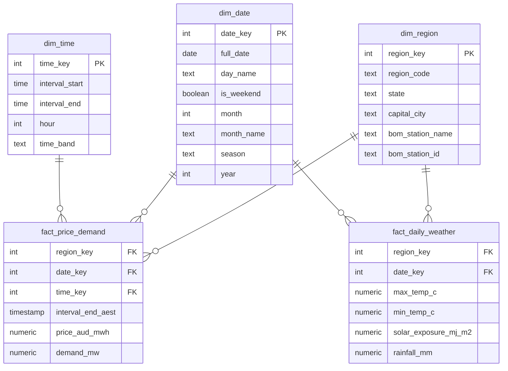

# Star Schema Design

## Why a star schema

Raw AEMO and BOM files repeat the same details on every row, such as the region name. A star schema stores the numbers once, in fact tables, and the details once, in small dimension tables. Keys link them together.

This keeps the data small, avoids mistakes, and gives Power BI the shape it works best with.

## Diagram

## Grain - what one row means

| Table | One row means | Expected rows |
|---|---|---|
| fact_price_demand | One region, one 5-minute interval | about 525,600 (288 x 5 x 365) |
| fact_daily_weather | One region, one day | about 1,825 (5 x 365) |
| dim_region | One NEM region | 5 |
| dim_date | One calendar day | 365 |
| dim_time | One 5-minute slot in a day | 288 |

## Fact tables

### fact_price_demand

The main table. Price and demand for each region, every 5 minutes.

| Column | Meaning |
|---|---|
| region_key | Links to dim_region |
| date_key | Links to dim_date, e.g. 20260115 |
| time_key | Links to dim_time, e.g. 1430 for the 14:30 to 14:35 slot |
| interval_end_aest | The original AEMO timestamp, kept for checking |
| price_aud_mwh | Dispatch price in $/MWh. Negative and very high prices are kept |
| demand_mw | Regional demand in MW |

### fact_daily_weather

Daily weather for each region, from one BOM station per region.

| Column | Meaning |
|---|---|
| region_key | Links to dim_region |
| date_key | Links to dim_date |
| max_temp_c | Daily maximum temperature (°C) |
| min_temp_c | Daily minimum temperature (°C) |
| solar_exposure_mj_m2 | Daily solar exposure (MJ/m²) |
| rainfall_mm | Daily rainfall (mm) |

## Dimension tables

### dim_region

| Column | Example |
|---|---|
| region_key | 1 |
| region_code | NSW1 |
| state | New South Wales |
| capital_city | Sydney |
| bom_station_name | Sydney (Observatory Hill) |
| bom_station_id | 066062 |

### dim_date

| Column | Example |
|---|---|
| date_key | 20260115 |
| full_date | 2026-01-15 |
| day_name | Thursday |
| is_weekend | false |
| month / month_name | 1 / January |
| season | Summer (Dec to Feb, Southern Hemisphere) |
| year | 2026 |

### dim_time

| Column | Example |
|---|---|
| time_key | 1430 |
| interval_start | 14:30 |
| interval_end | 14:35 |
| hour | 14 |
| time_band | Afternoon (Night 00-06, Morning 06-12, Afternoon 12-18, Evening 18-24) |

## How weather fits in

Prices are every 5 minutes. Weather is once a day. These are two different grains.

I chose to keep weather in its own daily fact table, rather than copying it onto every 5-minute row or shrinking prices down to daily.

- Copying weather onto every row would repeat each value 288 times and mix two grains in one table
- Shrinking prices to daily would lose time of day, which my first question needs
- A separate daily table keeps each table at one grain

Both fact tables share dim_region and dim_date. This lets Power BI compare them. To compare price with weather, I roll prices up to a daily figure (such as daily peak demand) and join on region and date.

## Time rules

- **AEST all year.** AEMO uses market time (AEST, UTC+10) with no daylight saving. I use market days for all five regions. For SA and the daylight saving months, this is slightly different from the local calendar day. I accept this small offset and note it here
- **AEMO timestamps mark the end of an interval.** A row stamped 14:35 covers 14:30 to 14:35. I key each row by its interval start, so the row stamped 00:00 belongs to 23:55 on the previous day. This gives each day exactly 288 slots
- **BOM's 9am window.** BOM's daily values do not all cover midnight to midnight. Maximum temperature covers the 24 hours from 9am, so it mostly lines up with the same day's peak demand. Minimum temperature and rainfall cover the 24 hours to 9am, so they mostly describe the night and day before. I keep BOM's dates as published and will check whether this matters in M2

## What this design does not include

- Public holidays (could be added to dim_date later)
- Fuel mix, interconnectors and forecasts (out of scope, see scope.md)